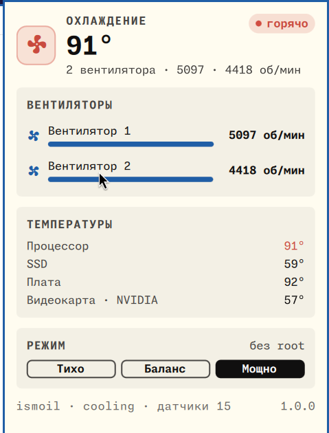

# Cooling for the Omarchy bar

[Русский](README.ru.md)

Fans and temperatures for any machine: the processor's temperature in the bar, coloured as it heats,
and a popup with every fan the kernel reports and its speed, temperatures by group, and the power mode.



- **Fans**: every `fanN_input` hwmon reports (hp-wmi, thinkpad_acpi, asus-wmi, dell-smm, nct6775,
  it87, acpi_fan…), their speed against the fastest one, a spinning icon while the popup is open.
  When Linux sees no fan, it says so.
- **Temperatures**: processor (package and the hottest core), graphics, SSD, board.
  A discrete NVIDIA GPU is read with `nvidia-smi` only while the popup is open, and only when it is
  awake: a sleeping GPU is never woken (that would drain the battery).
- **Modes — whatever this computer offers**, never a fixed list:
  - every profile power-profiles-daemon has (no root), quietest first, with plain names
    (power-saver → Quiet, balanced → Medium, performance → Powerful; an unknown name as it is);
  - **Auto** (the default, when there are two or more): the quietest profile while the computer rests,
    medium while it works (load or 70°+), never the loudest; it changes only after its reason held 20 s;
  - **Max**, only where a full-speed switch exists: fans at full speed. The first click opens the
    installer of a small root helper — your password is the only thing to type — and Max turns on as
    soon as it is in place; after that it needs no password. Where it works:

    | Hardware | How | Back to automatic |
    |---|---|---|
    | most laptops and boards (hp-wmi, asus-wmi, dell-smm, nct6775, it87 …) | hwmon `pwmN_enable = 0`, "no control, full speed" in the kernel's hwmon ABI | the values from before are put back exactly |
    | ThinkPad (`thinkpad_acpi fan_control=1`) | `/proc/acpi/ibm/fan` `level full-speed` | `level auto` |
    | MSI (`msi-ec`) | `cooler_boost on` | `off` |

    Graphics cards are never touched. With none of these the Max button does not appear.
  - The mode shown is read from `platform_profile`, so it is always the one in force.
  - Right click on the bar steps through the modes (Max left out).
- Colours: cool, warm from 75°, hot near the processor's limit (or 90°).

## Light on the system

`discover.py` finds the sensors once (and when the popup opens); after that the sensor files are
re-read in place every `interval` seconds, with no process.

## The Max helper (optional)

The widget runs `helper/install.sh` itself the first time Max is clicked (and when the installed
helper is older than it needs). It puts in place, and `helper/install.sh remove` takes out:

- `/usr/local/libexec/ismoil-fans-max` — takes one word, `max` or `auto`, nothing else; saves the fan
  settings it changes in `/run/ismoil-fans` and puts them back; `/run/ismoil-fans/max` tells the widget
  Max is on;
- a polkit action for it, and a rule letting administrators (`wheel`) run this one helper without a
  password: the shell runs in the user's systemd manager, outside the login session, where polkit has
  no agent to ask one;
- `ismoil-fans-auto.service`, which sets known fans (hp, asus, ThinkPad, MSI) back to automatic at boot.

## Install

```bash
omarchy plugin add https://github.com/ismoil77/omarchy-cooling --enable
```

Update with `omarchy plugin update ismoil.fans`.

## Remove

```bash
omarchy plugin remove ismoil.fans
```

Nothing is left behind.

## Settings

| Setting | Default | |
|---|---|---|
| `interval` | 3 | seconds between reads |
| `language` | auto | `en`, `ru`, or the system locale |
| `textSize` | Normal | Normal, Large, Extra large |
| `animations` | true | spinning fan icons |

## Requirements

`python3` (stdlib only). Optional: `power-profiles-daemon` for the mode switch, `nvidia-smi` for an
NVIDIA GPU. The widget itself never writes to `/sys` and needs no root; only the optional helper does,
through polkit.

## Tests

```bash
tests/run.sh   # discover.py and the helper against a fake /sys, /proc and /run; Model.js and Strings.js in Node; omarchy plugin validate
```

## License

MIT
